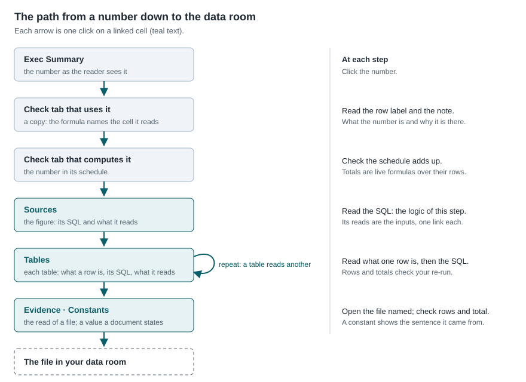
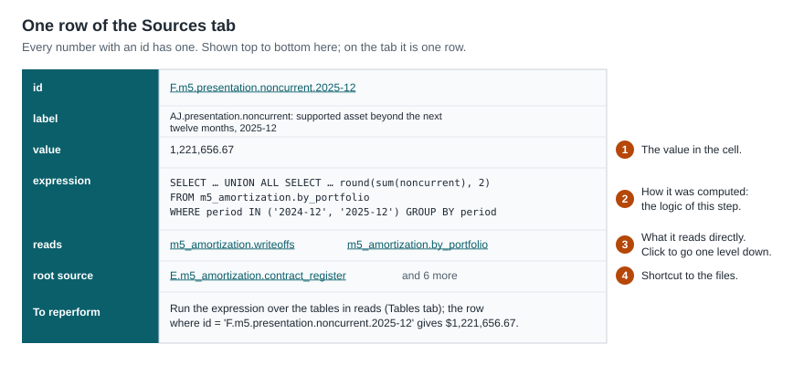
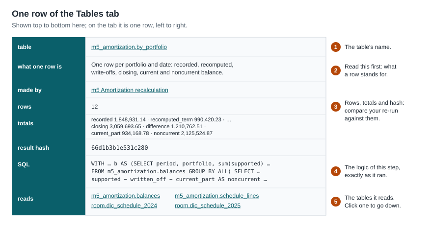
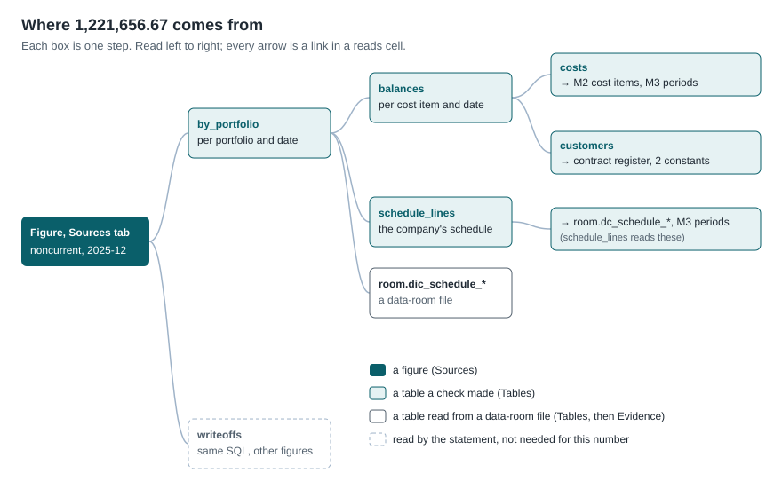
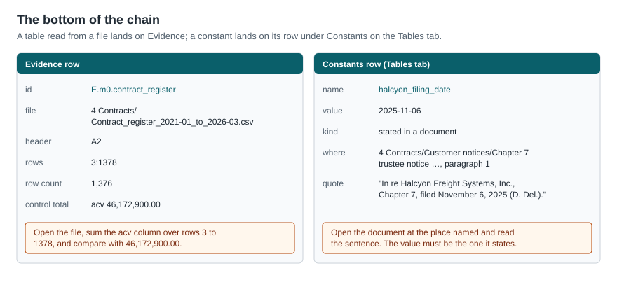

# Reperforming a number in a Countz workbook

Every number in a Countz workbook leads down, one click at a time, to rows of a file in
your data room. At each step the workbook shows the logic that produced the number and
what that logic read. This guide shows how to follow a number down and reperform it.

The example throughout comes from a contract costs workbook: the noncurrent portion of
contract cost assets at December 31, 2025, **1,221,656.67**.

## What you need

- The workbook.
- The data-room files, to check the bottom of the chain.
- To re-run a step row by row: the run folder and a SQL console (see
  [Re-running a step](#re-running-a-step)). Everything else needs only the workbook.

## The path down



A linked cell shows its text in teal. Clicking it takes you one step down. Four kinds of
tab carry the trail:

| Tab | What a row holds |
|---|---|
| A check tab | A schedule. A number another check computed is a formula naming the cell it copies. |
| Sources | One figure: its value, the SQL that computed it, and what that SQL reads. |
| Tables | One table: what a row stands for, the SQL that made it, what it reads, and its row count, totals and hash. Constants follow the tables, one row each. |
| Evidence | One read of a data-room file: the file, the rows read and the control total. |

## Following the example

### 1. Exec Summary

`Exec Summary!D37`, on the row *Noncurrent portion: the presentation adjustment*, shows
1,221,656.67. The formula bar shows `='m8 Reported to adjusted costs'!E49`: the number is
a copy. Click it.

### 2. The check tab that uses it

`m8 Reported to adjusted costs!E49` is on the walk from recorded to supported balances.
The row's note says why the adjustment exists: *The company presents all of it as
current.* The formula bar shows `='m5 Amortization recalculation'!D39`: M8 copied the
number from M5. Click it.

### 3. The check tab that computes it

`m5 Amortization recalculation!D39` holds the number itself, on the Presentation table.
Above it, the portfolio table splits the same amount by portfolio, and its total
(`J11`, a live `=SUM(J5:J10)`) agrees:

| Portfolio | Noncurrent |
|---|---:|
| new 12-month | 382,335.99 |
| new 24-month | 244,176.02 |
| new 36-month | 516,642.91 |
| expansion | 78,501.75 |
| renewal 12-month | 0.00 |
| implementation | 0.00 |
| **Total, December 31, 2025** | **1,221,656.67** |

D39 is the figure M5 computed. Click it to see how.

### 4. Sources: the figure



The **expression** is the whole logic of this step: add the `noncurrent` column of the
table `m5_amortization.by_portfolio` for each date. **reads** lists what the expression
reads, one link per cell. **root source** jumps straight to the data-room files if you
want to skip the steps between.

`writeoffs` appears in reads because the same statement also computed the write-off
figures. This number's row reads only `by_portfolio`. The expression shows which part of
the statement produced which figures.

Click `m5_amortization.by_portfolio`.

### 5. Tables: one step down



Read **what one row is** first, then the **SQL**. For `by_portfolio`, each portfolio's
noncurrent amount is the supported balance, less what was written off, less what
amortizes in the next twelve months. Those three amounts come from
`m5_amortization.balances`. Click it.

### 6. Keep going

Each Tables row works the same way. The branches below `by_portfolio`:



- **balances**: one row per cost item and date. Its SQL holds the amortization formula:
  amount × (supported period − months elapsed) ÷ supported period. A cost for a customer
  who left by that date is written off in full.
- **customers**: one row per customer, with the date they left and how. Its SQL shows the
  rules: the last contract's status decides expired, terminated or canceled, and the two
  constants name the customer in bankruptcy and its filing date.
- **costs**: the cost items carried as an asset. It leads to M2's cost items (commission
  lines, employer taxes and referral fees, each recomputed from its plan) and to M3's
  supported amortization period for each contract.

Follow the branch that matters to your question. To question a write-off, follow
`customers`. To question a balance, follow `costs`.

### 7. The bottom



A table read from a file shows the file, the rows read and a control total on its
Evidence row. Open the file and check the total. A constant shows the sentence it was
taken from; open the document and read it.

## Reading a step

Every step has the same three parts:

1. **What a row is.** One sentence on the Tables row, written when the table was made.
2. **The logic.** The SQL, exactly as it ran. `FROM` and `JOIN` name the tables read;
   `WHERE` keeps some rows; `GROUP BY` adds rows up; `CASE WHEN` applies a rule.
3. **The inputs.** The reads cells, one link each.

When a step reads two or more tables, each one is its own link. The SQL's `JOIN … ON` or
`JOIN … USING (…)` names the columns that match a row of one table to a row of the other.
To check a join, compare the row counts on the Tables rows of its inputs with the row
count of its output: an inner join keeps only the rows that found a match.

## Reperforming

**A figure computed from other figures.** Everything you need is in the workbook. Each
figure the expression reads is a link to its own Sources row, with its value. Do the
arithmetic.

**A step that reads tables.** The workbook holds each table's row count, totals and
result hash, not its rows. Re-run the step's SQL (below) and compare:

- **rows**: the number of rows your re-run returns;
- **totals**: the sum of each money column over every row of the table, all dates
  together. They are not balances. They show which column differs when a re-run does not
  match;
- **result hash**: the SQL console prints a hash for a result of ten rows or more. The
  same hash means the same rows.

**The data-room file.** Open it and check the rows read and the control total on its
Evidence row.

### Re-running a step

The run folder holds every table and the catalog that names them. In Claude, ask:

> Re-run the SQL of `m5_amortization.by_portfolio` from the run folder and compare it
> with the workbook.

Or run it yourself with the plugin's SQL console, from the run folder:

```
countz-sql -agent -init catalog.sql -c "SELECT * FROM m5_amortization.by_portfolio"
```

Paste a Tables row's SQL in place of the `SELECT` to re-run that step. The console prints
the rows and, at the end, the row count and hash to compare with the Tables row.

## What the workbook does not hold

- **The rows of each table.** The workbook carries the totals; the rows are in the run
  folder.
- **The logic in words, column by column.** The description says what a row is. How each
  column is computed is in the SQL.

## Quick reference

| You are on | Read | Check | Click |
|---|---|---|---|
| A check tab | the row label and note | totals add up (live formulas) | the number |
| Sources | the expression | the arithmetic, if it reads figures | a reads cell |
| Tables | what one row is, then the SQL | rows, totals and hash against your re-run | a reads cell |
| Evidence | the file and rows | the control total in the file | — |
| Constants | the quote | the sentence in the document | — |
